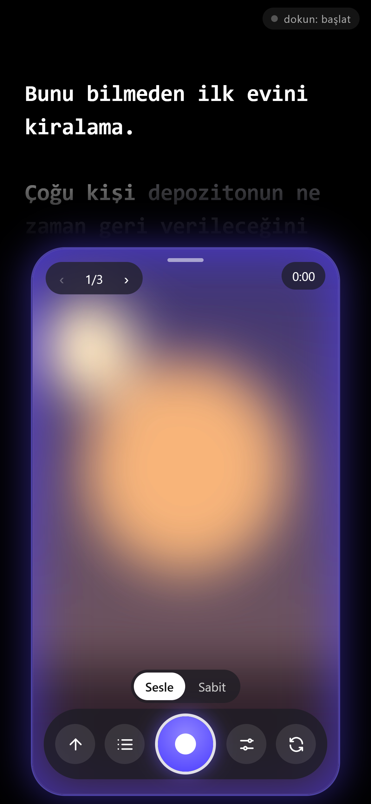
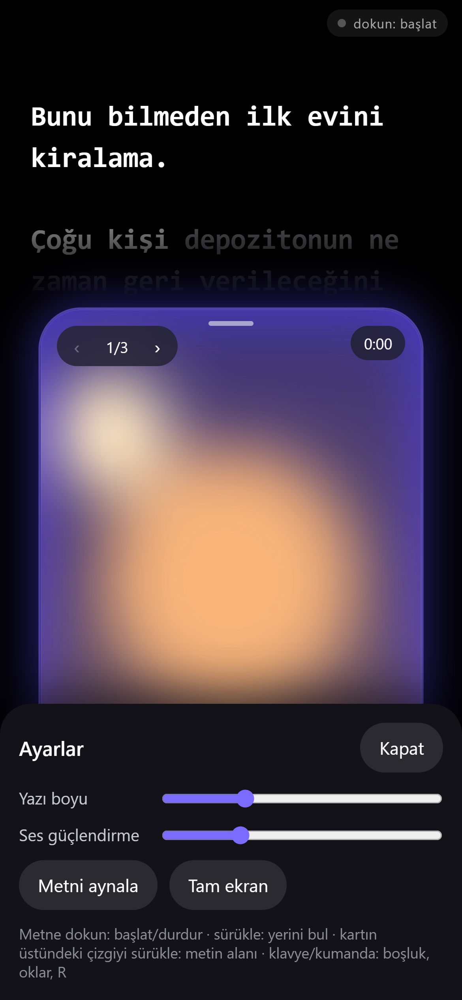
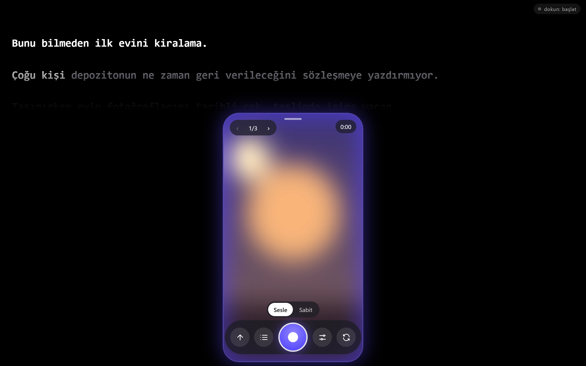

# Text × Camera — sesini takip eden telefon teleprompter'ı

Telefonda video çekerken metni ekranda okumak için yazdığım web uygulaması. Metin kameranın hemen altında akar, böylece okurken kameraya bakıyor görünürsün. Sen konuştukça metin seni takip eder: hızlanırsan hızlanır, durursan durur. Reels ve kısa video çekimleri için bölümler ve hazır şablonlar var.

**Canlı:** [mertbrks.github.io/text-x-camera](https://mertbrks.github.io/text-x-camera/) (telefonda aç, Paylaş → Ana Ekrana Ekle)

*A phone teleprompter web app: the script scrolls right under the front camera and follows your voice using the browser's speech recognition, with a small fuzzy matcher tuned for Turkish suffixes. Records video with a countdown, splits scripts into takes, works offline as a PWA.*

## Ekran görüntüleri

*Kamera görüntüsü yerine soyut bir test görüntüsü kullanıldı.*

<p>
  
  &nbsp;
  
</p>

*Çekim ekranı: üstte metin (okunan kelimeler beyaz, sıradakiler soluk), altta kamera kartı · Ayarlar paneli*

**Bilgisayarda:** aynı sayfa geniş ekranda da çalışır, klavye ya da Bluetooth sayfa çevirici ile kontrol edilir


## Ne yapıyor

- **Sesimi takip et:** tarayıcının konuşma tanıması (Türkçe) dinler; duyulan son 1-3 kelime metinde, bulunduğun yerden en fazla 20 kelime ileride aranır. Türkçe ekler kelime sonunu değiştirdiği için ("rengini" / "rengi") 4 harflik ortak kök eşleşme sayılır. Metin hiçbir zaman geri gitmez; tek kelimelik eşleşmeye yalnızca hemen yakındaysa güvenilir.
- **Sabit hız:** konuşma tanıma yoksa ya da istemezsen metin seçtiğin hızda akar; hız kartın yanındaki tekerlekle değişir. Konuşma tanıma hata verirse uygulama kendiliğinden sabit hıza geçer.
- **Kayıt:** 3 saniyelik geri sayım, kayıt ve metin birlikte başlar. Kayıtta yalnızca durdurma düğmesi kalır, ekran kararmaz. Çekim bitince izle, indir ya da doğrudan paylaş.
- **Ses güçlendirme:** kısık konuşmalar için kazanç + kompresör; yüksek sesler patlamaz.
- **Bölümler:** metne `---` satırı koyarsan her bölüm ayrı çekim olur. Takıldığın bölümü baştan almak için yalnızca onu yeniden çekersin.
- **Reels şablonları:** Kanca → Sorun → Çözüm → Çağrı, Önce / Sonra, Kutuda ne var?, Yanlış bilinen.
- **Kontrol:** metne dokun: başlat / durdur; sürükle: yerini bul; kartın üstündeki çizgiyi sürükle: metin alanını büyüt. Klavye: boşluk (başlat/durdur), oklar (satır ve bölüm), R (kayıt).
- **Diğer:** ön / arka kamera, metni aynalama (gerçek teleprompter camı için), yazı boyu, tam ekran. Uygulamadan çıkınca kamera ve mikrofon kapanır, dönünce yeniden açılır.

## Teknik

- Tek sayfa: `index.html` (HTML, CSS, JavaScript; framework yok). Sunucu yok, hiçbir veri dışarı gitmez.
- Web Speech API (`tr-TR`), MediaDevices + MediaRecorder, Web Audio (GainNode + DynamicsCompressor), Screen Wake Lock, Web Share.
- Kamera önizlemesi videonun kendi oranında gösterilir, kırpılmaz.
- PWA: `manifest.json` + `sw.js` (önce ağ, çevrimdışında önbellek).

```
index.html       arayüz, kamera, kayıt, kaydırma ve ayarlar
match.js         konuşma ile metni eşleştiren küçük fonksiyon (Türkçe kök eşleşmesi)
match.test.js    eşleştirme testleri
_test.html       tarayıcı testi: sahte konuşma tanıma ile uçtan uca kontroller
sw.js            çevrimdışı önbellek
```

## Yerelde çalıştırma

```bash
python -m http.server 8000      # http://localhost:8000  (kamera için localhost ya da https gerekir)
node match.test.js              # eşleştirme testleri
```

## Sınırlar

- Konuşma tanıma tarayıcıya bağlı: Chrome ve Safari destekliyor, Firefox desteklemiyor (orada sabit hız kullanılır).
- Bazı telefonlar konuşma tanıma ile video kaydına mikrofonu aynı anda vermiyor; bu durumda uygulama sabit hıza geçer.
